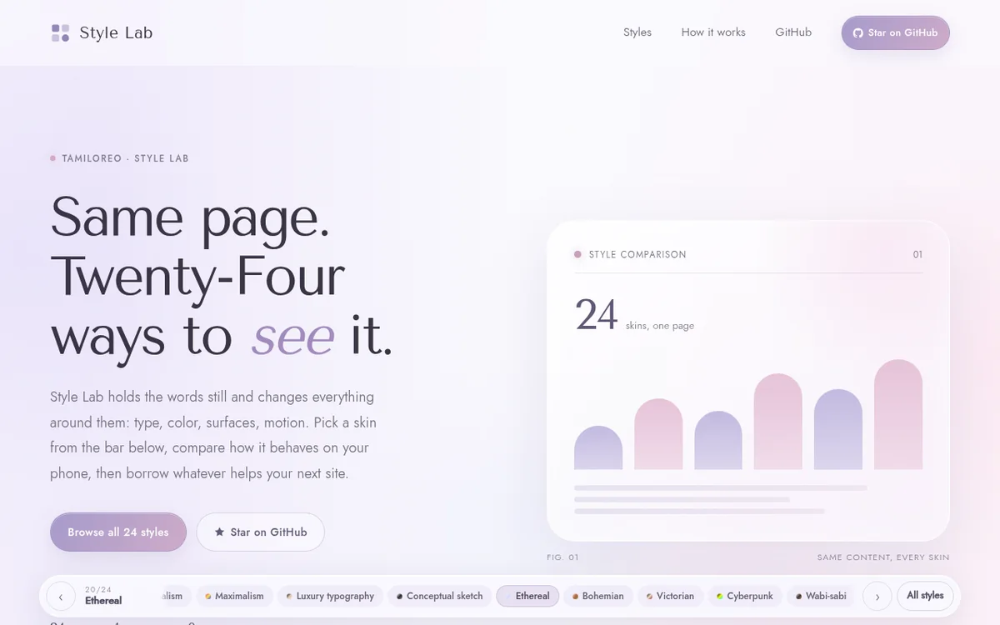
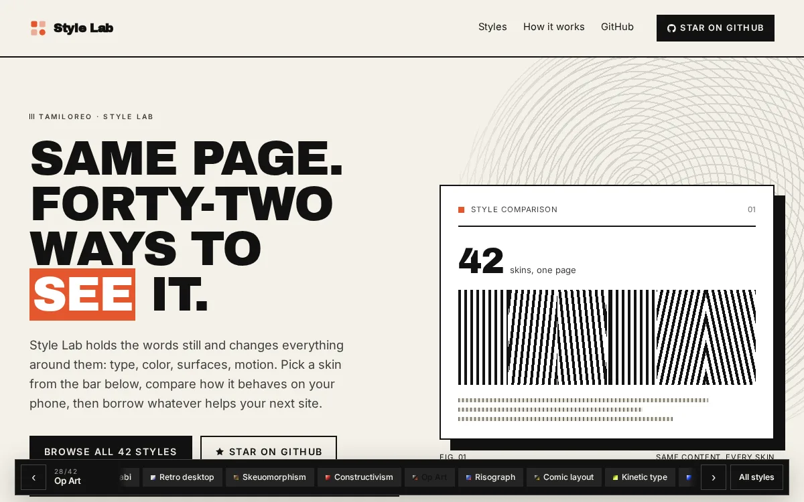
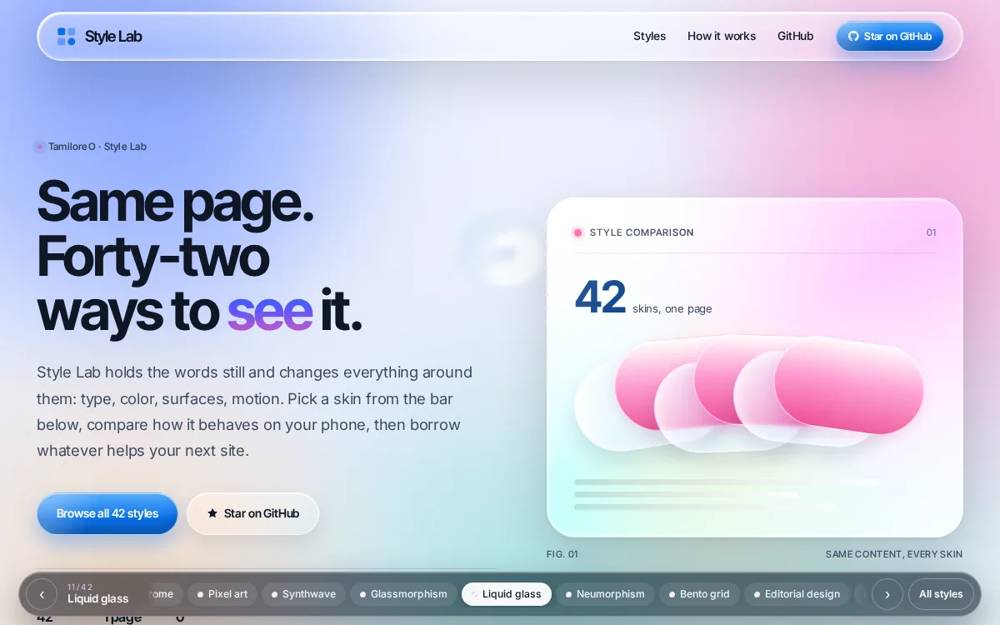
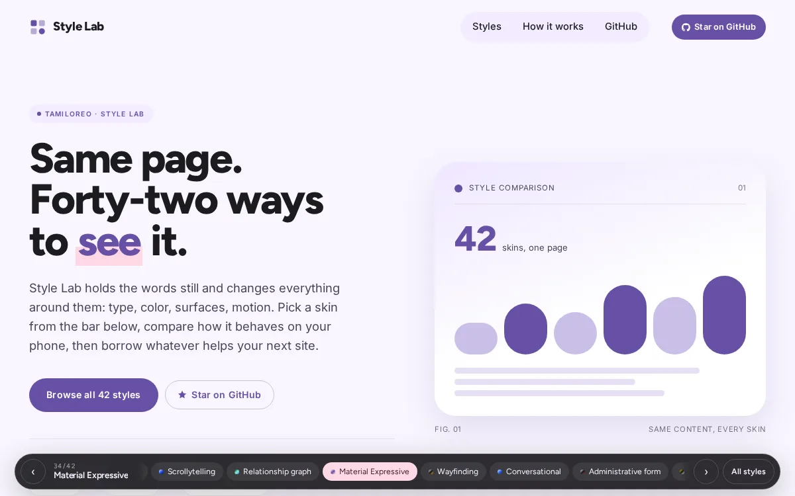
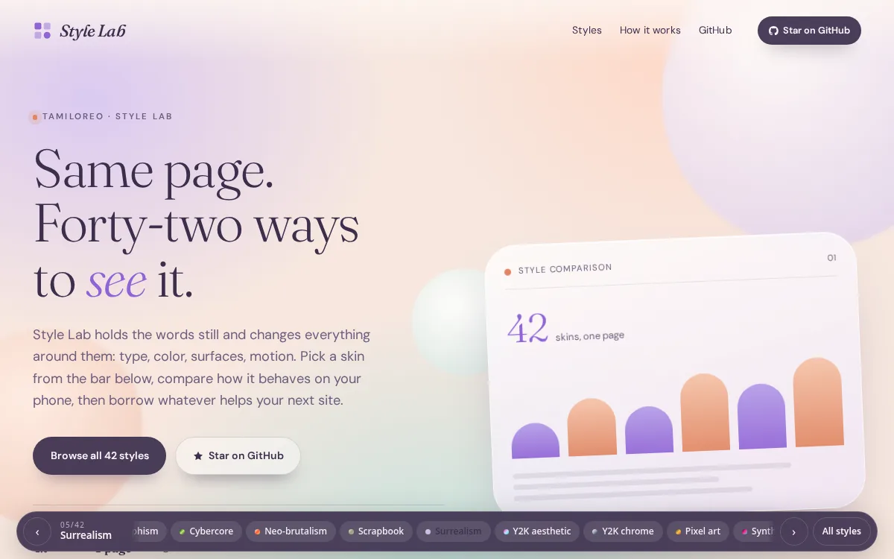
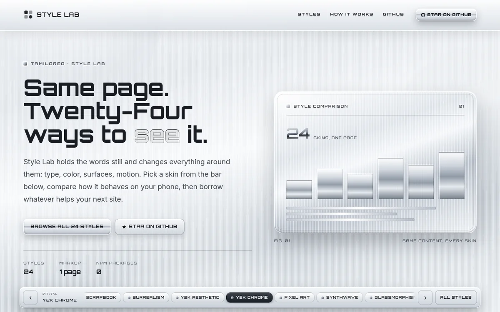

# Style Labs

In a current world of AI Slop, we can unslop ourselves by remembering what it is to be creative. "AI as a tool, not as a masthead".

Style labs is a playground for comparing interface styles on one page. The content stays the same but the typography, color, spacing and surfaces etc. change. Use the bar at the bottom to switch styles and borrow ideas for your next site. Share with others and suggest additions to this.

Live at **https://tamiloreo.github.io/style-labs/**

## Samples

Six of the styles in the lab. Each image opens that style, and a daily GitHub Action swaps in a fresh set.

<!-- samples:start -->
<table>
  <tr>
    <td></td>
    <td></td>
  </tr>
  <tr>
    <td></td>
    <td></td>
  </tr>
  <tr>
    <td></td>
    <td></td>
  </tr>
</table>
<!-- samples:end -->

## Files

| Path | Purpose |
| --- | --- |
| `src/index.html` | Page template; counts and the ticker are filled in at build time |
| `src/registry.json` | The only list of styles: id, name, note, swatch and fonts |
| `public/index.html` | Generated page with every count already resolved |
| `public/registry.js` | Generated style list the page and runtime read |
| `public/boot.js` | Picks the saved style and loads its sheet before first paint |
| `public/app.js` | Switcher, prefetching and saved preference |
| `public/ripple.js` | Water field behind the liquid glass skin, driven by scroll and touch |
| `public/styles/base.css` | Shared layout and tokens |
| `public/styles/<style-id>.css` | One stylesheet per style, loaded on demand |
| `public/styles/controls.css` | Responsive and accessibility safeguards |
| `public/sw.js` | Service worker precache for instant repeat visits |
| `public/styles.css` | Full bundle, kept for older links |
| `src/styles/00-base.css` | Source for the shared layout and tokens |
| `src/styles/<style-id>.css` | Source for each design system |
| `src/styles/zz-controls.css` | Source for the safeguards |
| `build.mjs` | Splits and minifies the CSS, renders the page, writes `registry.js`, `boot.js` and `sw.js` |
| `scripts/rotate-gallery.mjs` | Rebuilds the sample gallery below |
| `assets/screenshots/` | One screenshot per style |
| `.github/workflows/pages.yml` | Builds and deploys to GitHub Pages |
| `.github/workflows/rotate.yml` | Rotates the samples each morning |

## License

MIT. See [LICENSE](LICENSE).
