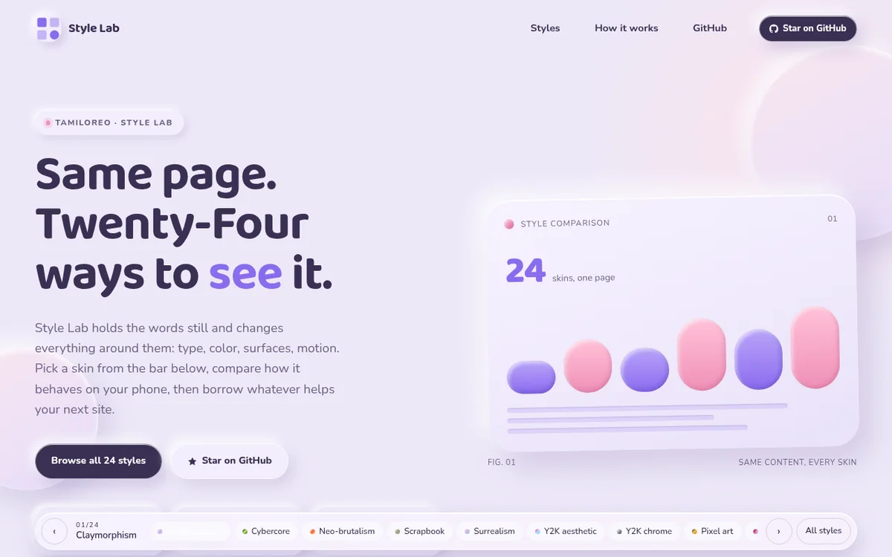
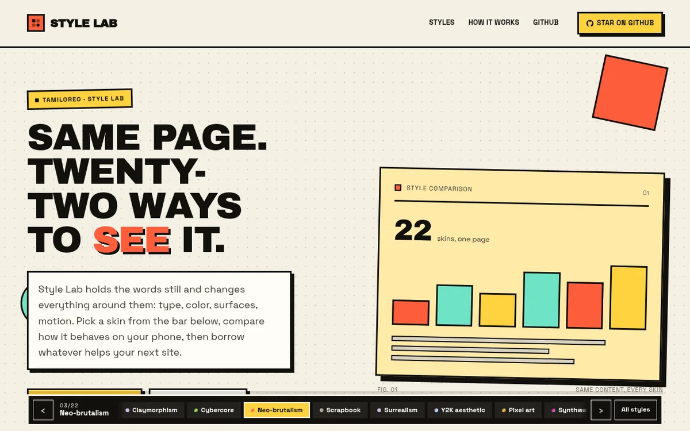
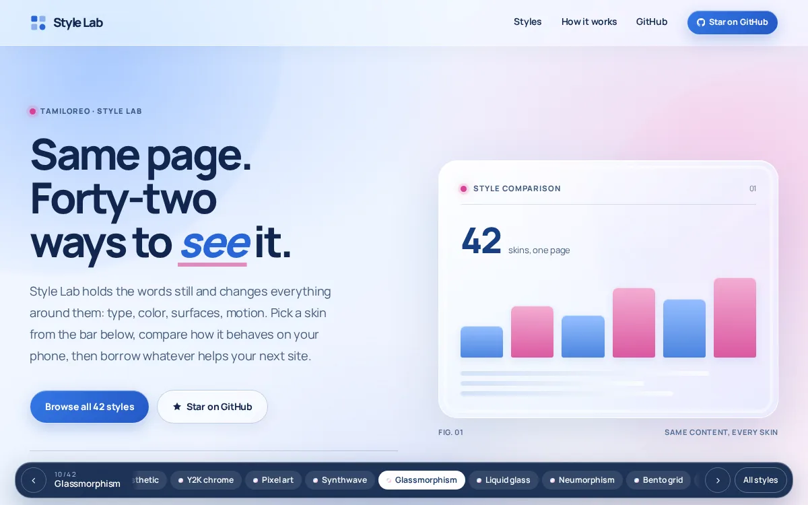
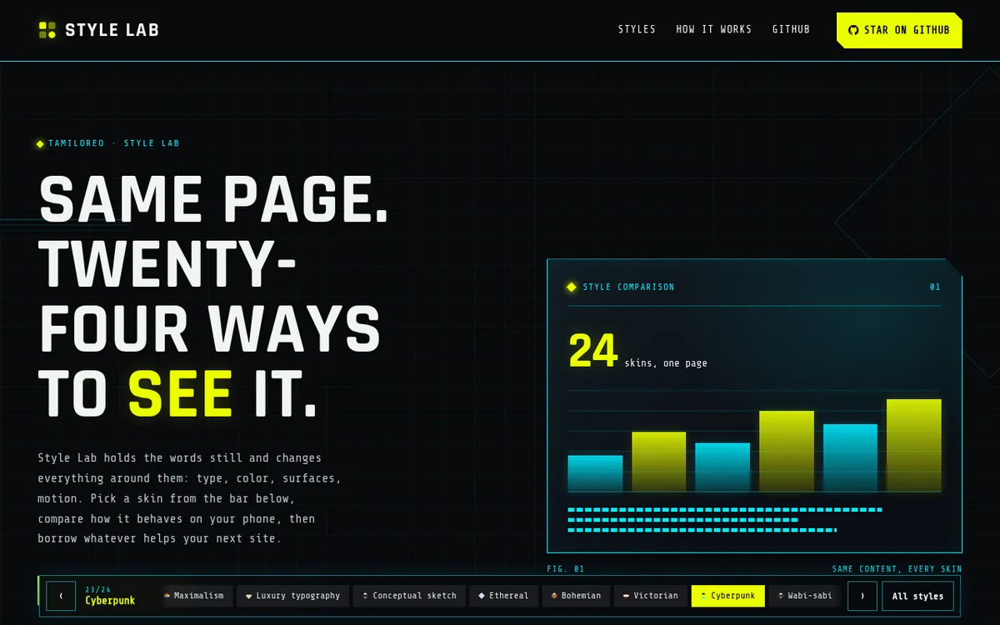

# Style Lab

A playground for comparing interface styles on one page. The content stays the same; the typography, color, spacing and surfaces change. Use the bar at the bottom to switch styles and borrow ideas for your next site.

Live at **https://tamiloreo.github.io/style-labs/**

## Samples

Five of the twenty-two styles. Each image opens that style.

<table>
  <tr>
    <td></td>
    <td></td>
  </tr>
  <tr>
    <td></td>
    <td></td>
  </tr>
  <tr>
    <td></td>
    <td></td>
  </tr>
</table>

## Files

| Path | Purpose |
| --- | --- |
| `public/index.html` | Page content and structure |
| `public/app.js` | Style list, switching, keyboard and saved preference |
| `public/styles.css` | Generated stylesheet bundle |
| `src/styles/00-base.css` | Shared layout and tokens |
| `src/styles/<style-id>.css` | One stylesheet per style |
| `src/styles/zz-controls.css` | Responsive and accessibility fixes |
| `build.mjs` | Combines the CSS into `public/styles.css` |
| `.github/workflows/pages.yml` | Builds and deploys to GitHub Pages |

## License

MIT. See [LICENSE](LICENSE).
