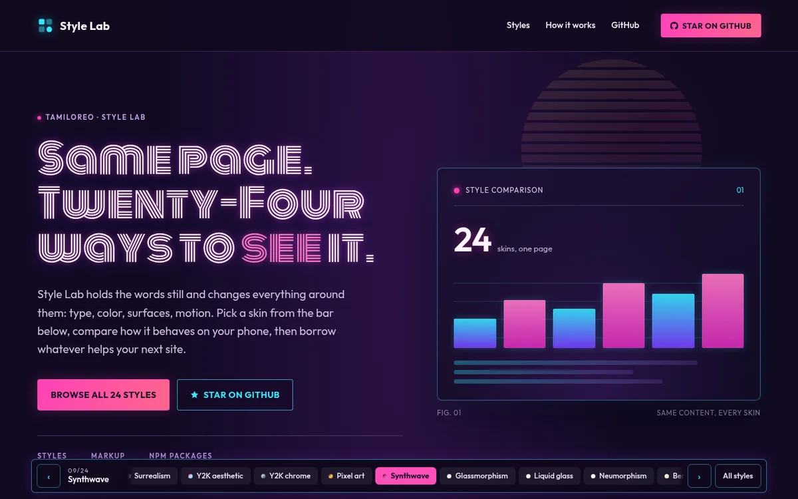
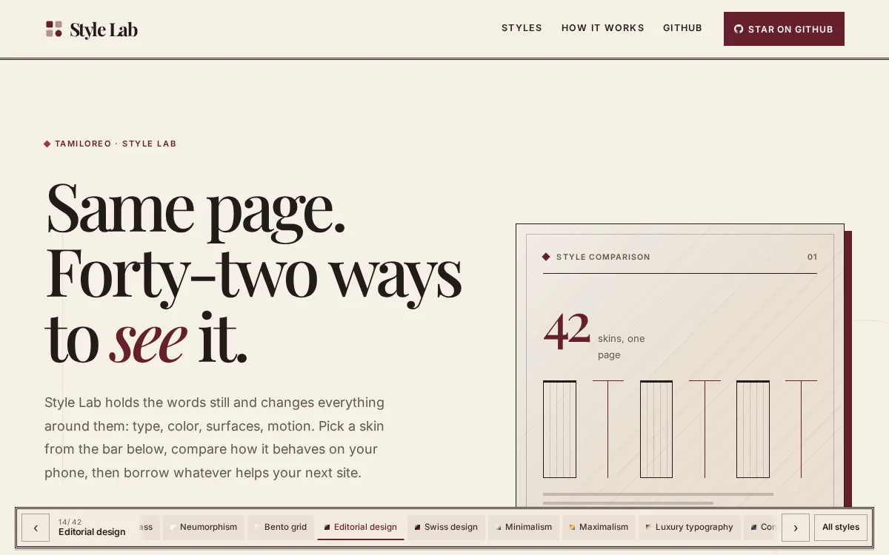
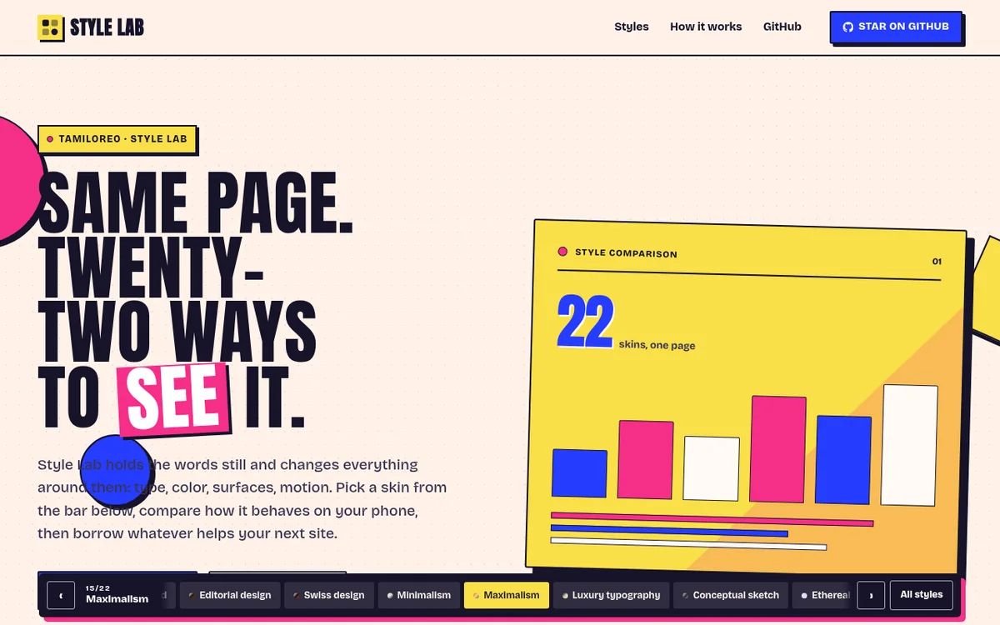
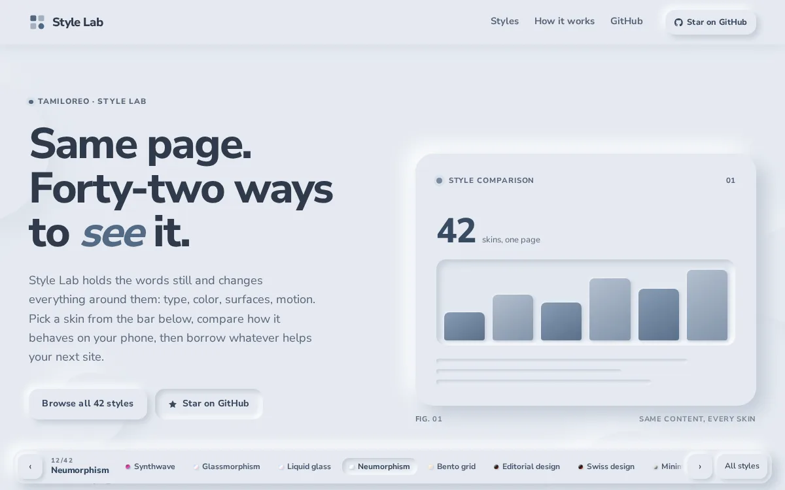
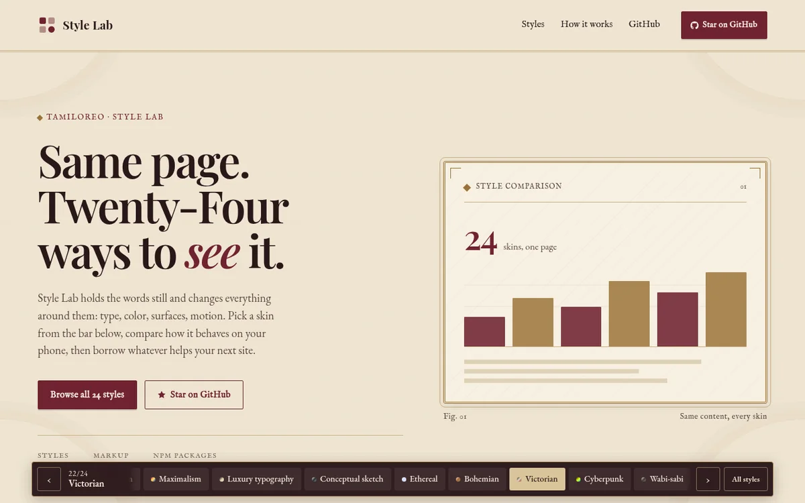

# Style Lab

A playground for comparing interface styles on one page. The content stays the same; the typography, color, spacing and surfaces change. Use the bar at the bottom to switch styles and borrow ideas for your next site.

Live at **https://tamiloreo.github.io/style-labs/**

## Samples

Five of the twenty-two styles. Each image opens that style, and a daily GitHub Action swaps in a fresh set.

<!-- samples:start -->
<table>
  <tr>
    <td></td>
    <td></td>
  </tr>
  <tr>
    <td></td>
    <td></td>
  </tr>
  <tr>
    <td></td>
    <td></td>
  </tr>
</table>
<!-- samples:end -->

## Files

| Path | Purpose |
| --- | --- |
| `public/index.html` | Page content and structure |
| `public/boot.js` | Picks the saved style and loads its sheet before first paint |
| `public/app.js` | Style list, switching, prefetching and saved preference |
| `public/styles/base.css` | Shared layout and tokens |
| `public/styles/<style-id>.css` | One stylesheet per style, loaded on demand |
| `public/styles/controls.css` | Responsive and accessibility safeguards |
| `public/sw.js` | Service worker precache for instant repeat visits |
| `public/styles.css` | Full bundle, kept for older links |
| `src/styles/00-base.css` | Source for the shared layout and tokens |
| `src/styles/<style-id>.css` | Source for each design system |
| `src/styles/zz-controls.css` | Source for the safeguards |
| `build.mjs` | Splits and minifies the CSS, writes `boot.js` and `sw.js` |
| `scripts/rotate-gallery.mjs` | Rebuilds the sample gallery below |
| `assets/screenshots/` | One screenshot per style |
| `.github/workflows/pages.yml` | Builds and deploys to GitHub Pages |
| `.github/workflows/rotate.yml` | Rotates the samples each morning |

## License

MIT. See [LICENSE](LICENSE).
